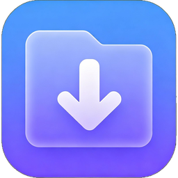

<div align="center">



# 解析下载器

批量下载 X、抖音、B 站上的图片与视频。

[](LICENSE)
[](https://github.com/Chamuyi/parse-dl/releases)
[](#-技术栈)

</div>

## ⚠️ 使用前说明

- 只支持 **Windows 10 64 位及以上**；需要 **WebView2 Runtime**（Win11 自带，Win10 可能要单独装）。
- 需要你在应用内登录一次。凭据**只写在本机**，程序不发往任何第三方服务器。
- X / 抖音 / B 站三个模块都是读取页面自己已经取回的响应，**不生成、不计算平台的签名参数**。
- 请自行遵守各平台的服务条款，下载内容建议仅作个人备份。

## ✨ 功能

| 模块 | 能做什么 | 状态 |
|---|---|---|
| **X** | 按用户名 / ID 翻页抓取，日期与媒体类型过滤，批量下载图片、视频、GIF；主页解析已改为应用内原生界面，不再嵌浏览器 | ✅ 可用 |
| **抖音** | 内嵌浏览器按页面实际渲染出来的作品识别，多下载源与质量优先策略，图集与实况照片；支持「自动下载」按名单逐个主页抓取 | ✅ 可用 |
| **B 站** | 解析下载、批量下载（主页投稿 / 合集 / 系列 / 收藏夹）、弹幕与字幕、封面与元数据、MKV 内封 | ⚠️ **未完成、未经测试** |
| **下载管理** | X / 抖音 / B 站各自独立入口，各看各的队列；暂停 / 继续 / 单条重试 / 一键重试失败项；失败自动换源并退避重试 | ✅ 可用 |
| **落盘命名** | 目录与文件名模板可自定义；同文件跳过（点重试也不会落出一堆重复副本） | ✅ 可用 |
| **外观** | 主题色（预设 + 自定义色轮）、窗口材质、导航形态 | ✅ 可用 |

### ⚠️ 关于 B 站模块

**B 站下载相关的模块还没有做好，也没有经过测试。**

代码已经写进去了（`ParseDl/Services/Bili/` 下 19 个文件，含取流、WBI 签名、弹幕、字幕、封面、元数据、合并管线等），
但**没有在真机上完整跑通验收**，登录态相关的能力（1080P 档位、字幕、自建收藏夹列表）也没有验证过。

实际可能遇到的情况：

- 部分稿件解析失败或取到的清晰度低于预期；
- 弹幕 / 字幕 / 封面 / 元数据等附加文件可能缺失或格式不对；
- 批量抓取（主页投稿、合集、系列、收藏夹）可能翻不完或漏抓；
- MKV 内封可能失败。

**请先把 B 站模块当成实验性功能看待。** X 与抖音两个模块是经过真机验证的。

## 🧱 技术栈

| 项 | 值 |
|---|---|
| 界面 | **WinUI 3**（Windows App SDK 2.5.1） |
| 运行时 | .NET 10（`net10.0-windows10.0.26100.0`） |
| 下载引擎 | 随包 `aria2c`（独立子进程 + 本地 JSON-RPC） |
| 媒体合并 | 随包 `ffmpeg` |
| 页面抓取 | WebView2（共享同一 user data folder，登录态一致） |

> 本仓库在 2026-11 从 Flutter 版**整体重构为 WinUI 3 版**。
> 旧的 Flutter 实现仍保留在 `lib/` 下供参考，但**不再是构建目标**，`dotnet build` 不会碰它。
> 想找旧的 Flutter 版可执行文件，见 [Releases](https://github.com/Chamuyi/parse-dl/releases) 里 v1.3 及更早的包。

## ⬇️ 下载

去 **[Releases](https://github.com/Chamuyi/parse-dl/releases)** 下载安装包
（附件名 `解析下载器_<版本>_x64-setup.exe`，1.5 版约 51.5 MB）。

数据（设置、日志、下载台账、各平台登录态）都在 **exe 同级的 `userdata\`** ——
装在哪就在哪，卸载前想留就整个目录拷走。不含遥测，不自动更新。

## 🔨 从源码构建

```bash
cd ParseDl
dotnet build ParseDl.csproj -c Release -p:Platform=x64
```

产物在 `ParseDl/bin/x64/Release/net10.0-windows10.0.26100.0/win-x64/`。

> ⚠️ **不要把仓库放在含中文的路径下**。实测中文目录名会让 `flutter analyze` 崩
> （LSP 通道的 JSON 解析报 `FormatException: Unterminated string`）。
> WinUI 构建本身不受影响，但仓库里仍有 Flutter 侧的辅助脚本。

打安装包：

```bash
python installer/build_installer_winui.py
```

需要 NSIS（默认找 `C:/Program Files (x86)/NSIS`）。

## 🧪 自测

```bash
<产物目录>\解析下载器.exe --selftest
```

结果写到 `userdata/selftest.txt`，覆盖解析、台账、命名模板、滚动状态机等离线用例。
**注意**：自测里有若干条历史遗留失败项（H.264 源、BGM 地址、视频变体数、批量上限截断），
与 B 站模块无关，属已知未修。

## 📄 许可证

基于开源项目 [X-Spider](https://github.com/MiningCattiva/x-spider) 二次开发，
整体遵循 **GPL-3.0-or-later**。全文见 [LICENSE](LICENSE)，
第三方组件与出处说明见 [NOTICE](NOTICE.md)。

GPL-3.0 要求的是随程序附上许可证全文并作出声明，不要求每个源文件都带许可证头。
再分发时请把 `LICENSE`、`NOTICE` 和本节一起带走。
